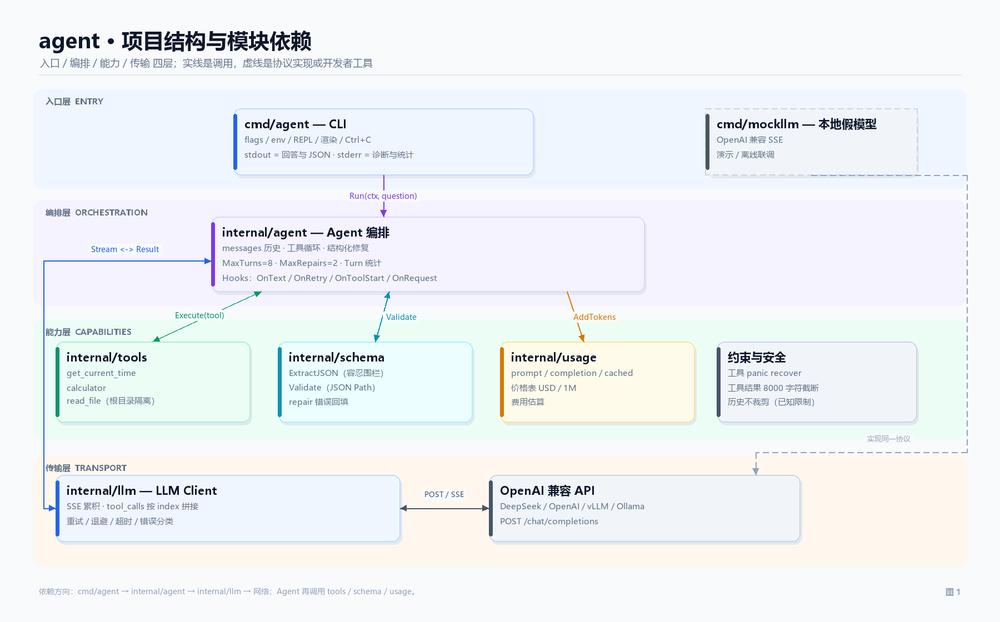

# agent — 一个把 LLM API 细节写清楚的 Go CLI

一个终端 Agent，用官方 [`openai/openai-go`](https://github.com/openai/openai-go) SDK 直接实现：

- OpenAI 兼容协议（DeepSeek 直接可用），SSE 流式输出；
- 完整的 tool calling 循环（`tool_calls` → 本地执行 → `tool` 消息回填 → 二次请求）；
- 结构化输出（JSON Schema 校验 + 把错误喂回模型重试）；
- 指数退避 + 限流重试、`Retry-After`、请求/轮次超时、`context` 取消；
- 每轮 token 与费用估算；
- 断网/401/429/5xx 等错误的中文可操作提示。

没有 LangChain 类封装：请求、流、循环、重试都在仓库里，方便讲清楚每一层。

## 目录

```
agent/
├── cmd/
│   ├── agent/                  # CLI：参数、REPL、流式渲染、Ctrl+C
│   └── mockllm/                # 本地 OpenAI 兼容 SSE 服务（演示/联调）
├── internal/
│   ├── llm/                    # SDK 包装：流式累积、重试、错误分类
│   ├── agent/                  # 工具调用循环、结构化输出修复
│   ├── tools/                  # 工具注册表 + 时间/计算器/读文件
│   ├── schema/                 # JSON Schema 子集校验 + JSON 提取
│   └── usage/                  # token 汇总、价格表、费用估算
├── schema/person.schema.json   # 结构化输出示例
├── scripts/demo.ps1            # 一键本地演示
├── .env.example
└── go.mod
```

## 快速开始

要求 Go 1.23+。

```powershell
# PowerShell
$env:DEEPSEEK_API_KEY = "sk-..."
go run ./cmd/agent "用一句话解释 SSE 流式输出"
```

```bash
# Bash
export DEEPSEEK_API_KEY="sk-..."
go run ./cmd/agent "用一句话解释 SSE 流式输出"
```

默认请求 `https://api.deepseek.com`、模型 `deepseek-chat`。也可以用 `--base-url` 接 OpenAI、vLLM、Ollama、OneAPI 等任何 OpenAI 兼容服务。

### 不花钱、断网也能跑：本地 mock

`cmd/mockllm` 是一个假模型服务，但严格按 SSE 协议输出，并且**故意把 tool call 的 arguments 切成 3 段**发送，用来演示流式拼接。

```powershell
# 终端 A
go run ./cmd/mockllm

# 终端 B
go run ./cmd/agent --base-url http://127.0.0.1:18080/v1 --api-key mock "现在几点？"
```

或者直接：

```powershell
powershell -ExecutionPolicy Bypass -File .\scripts\demo.ps1
```

## 演示

### 1. 流式输出 + token/费用

```text
$ go run ./cmd/agent --base-url http://127.0.0.1:18080/v1 --api-key mock --no-tools 你好
我是本地 mock 模型（没有真实智能）。你刚才说："你好"。

这个服务用于演示 SSE 流式输出、tool calling、重试与 token 统计。
把 --base-url 换成 https://api.deepseek.com 并设置 DEEPSEEK_API_KEY，就能得到真实模型的回答。
  [turn] in 114 · out 77 · est $0.000064 · 210ms
```

### 2. 工具调用循环

```text
$ go run ./cmd/agent --base-url http://127.0.0.1:18080/v1 --api-key mock "现在几点？"
  [tool] get_current_time {"timezone":"Asia/Shanghai"}
  [ok] get_current_time {"time":"2026-11-07T21:05:09+08:00","timezone":"Asia/Shanghai","unix":1794056709,"weekday":"Saturday"} (24ms)
现在是 2026-11-07T21:05:09+08:00（Asia/Shanghai）。这是通过 get_current_time 工具得到的真实系统时间。
  [turn] in 295 · out 60 · est $0.000108 · 2 requests · 1 tool call · 252ms
```

一次用户提问发生了 **2 次模型请求**：第一次返回 `tool_calls`，本地执行工具；把结果以 `tool` 角色回填后，第二次才生成最终回答。`in 295` 是两次请求的 prompt token 之和。

### 3. 结构化输出

```text
$ go run ./cmd/agent --base-url http://127.0.0.1:18080/v1 --api-key mock `
    --schema .\schema\person.schema.json "提取：Ada 36 岁，住在上海"
  [turn] in 606 · out 41 · est $0.000187 · 100ms
{
  "age": 30,
  "city": "示例文本",
  "name": "示例文本",
  "skills": [
    "示例文本"
  ]
}
```

stdout 只输出 JSON，`[turn]` 等诊断信息走 stderr，所以可以安全地 `| jq`。结构校验失败时，会把带 JSON Path 的错误回填给模型并重试。

### 4. 断网：优雅报错

```text
$ go run ./cmd/agent --base-url http://127.0.0.1:1 --max-retries 0 "hi"
  [error] 网络连接失败
          network: dial tcp 127.0.0.1:1: connectex: No connection could be made because the target machine actively refused it.
          无法连接 127.0.0.1:1：网络不可用、代理未生效或 Base URL 错误。可先运行本地 mock 验证客户端：go run ./cmd/mockllm ...
```

退出码：成功 `0`，调用失败 `1`，参数错误 `2`，Ctrl+C `130`。

## 用法

```text
agent [flags] "问题"         单轮提问，流式输出
agent ask [flags] "问题"     同上
agent [flags]                进入交互式 REPL
agent tools                  列出内置工具
agent version / help
```

flag 可以写在问题前，也可以写在问题后：

```powershell
agent --no-tools "你好"
agent "你好" --no-tools
agent "现在几点" --model deepseek-chat --verbose
```

前提是问题里的词不要以 `-` 开头（否则会被当成 flag）；需要时加 `--` 分隔：

```powershell
agent -- "-1 + 2 等于几"
```

常用参数：

| 参数 | 默认值 | 说明 |
| --- | --- | --- |
| `-model` | `deepseek-chat` | 模型名，也可用 `DEEPSEEK_MODEL` |
| `-base-url` | `https://api.deepseek.com` | 兼容 API 根地址 |
| `-api-key` | 空 | 优先读 `DEEPSEEK_API_KEY` / `OPENAI_API_KEY` |
| `-timeout` | `120s` | 单次 HTTP 请求（含流式读取） |
| `-turn-timeout` | `5m` | 单轮总超时（含工具），0 表示不限 |
| `-max-turns` | `8` | 单轮最多请求模型次数，防工具死循环 |
| `-max-retries` | `2` | 可重试错误的最大重试次数 |
| `-max-repairs` | `2` | 结构化输出校验失败后的修复次数 |
| `-max-tokens` | `0` | `max_tokens`，0 表示不发送 |
| `-temperature` | `1.0` | 传 `-1` 表示不发送该参数 |
| `-schema` | 空 | JSON Schema 文件路径，启用结构化输出 |
| `-json-mode` | `auto` | `auto\|object\|schema\|none` |
| `-tools` | 全部 | 逗号分隔，如 `calculator,get_current_time` |
| `-no-tools` | `false` | 禁用所有工具 |
| `-workdir` | `.` | `read_file` 的根目录 |
| `-show-reasoning` | `false` | 显示 `reasoning_content`（reasoner） |
| `-verbose` | `false` | 每个请求的 token / 重试 / 耗时明细 |
| `-price-in` / `-price-cached` / `-price-out` | 内置表 | 覆盖价格（USD / 1M tokens） |

REPL 命令：

```text
/help  /reset  /tools  /cost  /model <id>  /schema <path|off>
/system <text>  /verbose  /reasoning  /price  /exit
```

## 架构

更完整的图解（模块依赖、工具调用时序、主循环流程图）见 **[docs/architecture.md](docs/architecture.md)**。



```text
stdin / 参数
     │
     ▼
 cmd/agent ── 参数/环境变量、REPL、渲染、Ctrl+C
     │
     ▼
 internal/agent.Agent
     │  messages: system?, user, assistant(tool_calls), tool..., assistant
     ├──────────────► internal/llm.Client.Stream
     │                     │
     │                     ├─ openai-go SSE ──► Accumulator
     │                     │      text delta ──► OnText ──► stdout
     │                     │      tool_calls ──► 按 index 拼接
     │                     │      usage chunk ──► Tokens
     │                     │
     │                     └─ 429/5xx/网络 ──► 退避重试（有上限）
     │
     ├─ tool_calls ──► tools.Registry.Execute（超时/panic 保护/截断）
     │                     └─ 结果作为 tool 消息回填
     │
     └─ schema != nil ──► ExtractJSON → Validate → 失败则 repair 消息
                                                      └─ 追加一次请求
```

## 关键实现

### 1. 流式下 tool_calls 是分片到达的，必须按 `index` 拼

OpenAI 兼容的 SSE 里，一个 tool call 不是一次性发完的：

```text
chunk 1: {"index":0,"id":"call_1","type":"function","function":{"name":"get_current_time","arguments":""}}
chunk 2: {"index":0,"function":{"arguments":"{\"time"}}
chunk 3: {"index":0,"function":{"arguments":"zone\":\"Asia/Shanghai\"}"}}
```

规律：

- `id`、`name` 通常只在第一片出现；
- 后续分片只带 `index` 和一段 `arguments` 字符串；
- 多个工具调用可以交错到达（`index=0`、`index=1` 交替），**不能按到达顺序拼**；
- 必须用 `index` 作为 key，把 arguments 按到达顺序追加。

`internal/llm/accumulator.go` 的核心：

```go
buf, ok := a.byIndex[tc.Index]
if !ok {
    buf = &toolCallBuf{index: tc.Index}
    a.byIndex[tc.Index] = buf
    a.calls = append(a.calls, buf)
}
if tc.ID != "" {
    buf.id = tc.ID
}
buf.name = mergeName(buf.name, tc.Function.Name)
buf.args.WriteString(tc.Function.Arguments)   // 纯字符串拼接，不要每片单独 json.Unmarshal
```

流结束后再 `json.Unmarshal` 完整参数。每片单独解析一定失败，因为分片可能切在字符串、转义字符甚至数字中间。

`mergeName` 还兼容了少数网关“每次重发累计 name”的行为；正常 OpenAI/DeepSeek 只发一次，不会重复。

测试：`TestAccumulatorAssemblesToolCallFragmentsByIndex`、`TestAccumulatorKeepsParallelToolCallsSeparated`。

### 2. 工具循环：消息顺序不能错

一次工具调用后的下一次请求必须长这样：

```text
assistant(tool_calls=[{id:"call_1", type:"function", function:{name, arguments}}])
tool(tool_call_id="call_1", content="工具结果")
```

要点：

- assistant 消息里的 `id`、`name`、`arguments` 必须原样回填（arguments 是拼好的完整 JSON 字符串，不是对象）；
- 每个 tool call 都必须有对应的 tool 消息，`tool_call_id` 必须匹配；
- 多个工具调用时，tool 消息按调用顺序逐条回填；
- 工具执行失败不要中断循环：把 `ERROR: ...` 作为 tool 内容回填，模型通常能自行纠正或换一种方式回答。

`internal/agent/agent.go` 的循环：

```go
for step := 0; step < maxTurns; step++ {
    res, err := client.Stream(...)
    messages = append(messages, assistantParam(res))
    if len(res.ToolCalls) > 0 {
        for _, call := range res.ToolCalls {
            out := runTool(call)                       // 超时/panic/参数校验
            messages = append(messages, ToolMessage(out, call.ID))
        }
        continue
    }
    return res
}
```

### 3. 重试：只重试“确实值得重试”的错误

| 情况 | 重试 | 说明 |
| --- | --- | --- |
| 408 / 409 / 425 / 429 | ✅ | 429 优先使用响应头 `Retry-After` |
| 5xx | ✅ | 服务端瞬时错误 |
| 连接失败 / DNS / TLS 握手 / 连接重置 | ✅ | 指数退避 |
| 请求超时（本地 deadline） | ❌ | 重发可能再次超时、浪费配额 |
| 400 / 401 / 402 / 403 / 404 / 422 | ❌ | 参数、鉴权、余额问题，重试无意义 |
| 已输出第一个可见 delta | ❌ | 重试会重复输出 |
| `context` 被取消 | ❌ | 用户主动取消 |

退避公式：`min(base * 2^(n-1), max)`，再取 50%–100% 的 jitter；`Retry-After` 优先（上限 60s）。默认 `base=500ms`、`max=8s`、最多 2 次重试。

`TestRunRetriesRateLimitBeforeOutput` 验证 429 两次后成功；`TestNoRetryAfterPartialOutput` 验证已经输出 `par` 后不再重试；`TestRequestTimeoutIsNotRetried` 验证本地超时只尝试一次。

### 4. 超时与取消分三层

| 层 | 默认 | 作用 |
| --- | --- | --- |
| 单轮 turn | 5m | 包含多次模型请求 + 所有工具执行 |
| 单次请求 | 120s | 一次 `chat/completions` 的流式读取总时长 |
| 单个工具 | 30s | 防止工具卡死拖垮整轮 |

实现方式：

- 每层都用 `context.WithTimeout` 派生，取消会向下传播；
- 不使用 `http.Client.Timeout`（它会把“正在流式读取的长回答”也砍掉），而是把 deadline 放进 request context；
- CLI 层用 `signal.NotifyContext` / 自定义 `interruptState` 捕获 Ctrl+C：单轮模式取消后退出 130，REPL 模式取消当前请求但保留会话，再按一次退出。

### 5. 结构化输出：Schema 进 prompt + response_format + 本地校验 + repair

流程：

1. 把 JSON Schema 写进 system prompt，明确“只输出一个 JSON 值，不要 Markdown”；
2. 根据 provider 选择 `response_format`：
   - OpenAI：`{"type":"json_schema","json_schema":{...}}`；
   - DeepSeek：`{"type":"json_object"}`（DeepSeek 目前不支持 `json_schema`）；
   - `reasoner` 模型：`auto` 会选择 `none`，只靠 prompt + 本地校验，避开推理模型的参数限制；
   - `auto` 会按 base URL / 模型名自动选择，也可用 `-json-mode` 强制；
3. 模型返回后先 `ExtractJSON`（容忍 ```json 围栏和前后废话），再按 Schema 校验；
4. 校验失败：把**带 JSON Path 的具体错误**追加成一条 user 消息，再请求一次（默认最多 2 次修复）；
5. 仍然失败：返回 `StructuredError`，打印所有错误并退出 1。

为什么要本地再校验一遍？即使 `json_schema` 有 strict 模式，也可能遇到：provider 不支持、模型输出被网关改写、`json_object` 只保证“是 JSON”不保证“符合 Schema”、网络截断。**服务端约束是优化，本地校验才是底线。**

Schema 支持的范围：`type`（含类型数组）、`properties`、`required`、`additionalProperties`、`items`、`enum`、`const`、`minimum/maximum`、`minLength/maxLength`、`minItems/maxItems`、`pattern`、`anyOf/oneOf/allOf`。不支持 `$ref`，遇到会明确报错而不是静默忽略。

### 6. token 与费用

流式请求必须显式要求 usage：

```go
StreamOptions: openai.ChatCompletionStreamOptionsParam{
    IncludeUsage: param.NewOpt(true),
}
```

服务端会在 `[DONE]` 前多发一个 `choices: []` 的 chunk，里面是整次请求的 usage。中断的流可能收不到这个 chunk，此时只能显示 0 并提示。

DeepSeek 的 usage 还带 `prompt_cache_hit_tokens` / `prompt_cache_miss_tokens`，SDK 会放进 `ExtraFields`；代码优先读它，读不到再退回 OpenAI 的 `prompt_tokens_details.cached_tokens`。

计费公式（`internal/usage`）：

```text
uncached = prompt - cached
cost = uncached/1e6 * input_price
     + cached/1e6   * cached_input_price
     + completion/1e6 * output_price
```

默认价格表（USD / 1M tokens，可能过期，以账单为准）：DeepSeek `0.28 / 0.028 / 0.42`，GPT-4o `2.50 / 1.25 / 10.00`，GPT-4o-mini `0.15 / 0.075 / 0.60`。可用 `--price-in` 等参数覆盖。

### 7. 错误分类

`internal/llm/errors.go` 把底层错误归为 `network / timeout / auth / payment / rate_limit / server / bad_request / not_found / stream / canceled`，每类给一个中文 `Summary()` 和可执行的 `Hint()`，而不是把 SDK 的原始 JSON 直接糊到用户脸上。

例如：

- 401 → 检查 `DEEPSEEK_API_KEY` 是否与 base URL 匹配；
- 402 → 余额不足；
- 404 → 检查 base URL 是否少了 `/v1`、模型名是否存在；
- 400 → 常见是模型不支持 `response_format=json_schema`、上下文超长；
- 网络 → 检查代理，或先用本地 mock 排除客户端问题。

## 测试

```powershell
go test ./... -count=1
go vet ./...
```

涉及网络的测试全部使用 `httptest` 启动假 SSE 服务，不需要 Key、不访问外网。重点用例：

| 用例 | 覆盖点 |
| --- | --- |
| `TestAccumulatorAssemblesToolCallFragmentsByIndex` | 分片 arguments 拼接 |
| `TestAccumulatorKeepsParallelToolCallsSeparated` | 多工具 index 交错 |
| `TestAccumulatorTextReasoningAndDeepSeekUsage` | 文本/reasoning/DeepSeek 缓存 token |
| `TestRunExecutesToolAndFeedsResultBack` | 完整工具循环 + 第二次请求的消息结构 |
| `TestParallelToolCallsAreExecutedInIndexOrder` | 多个工具调用按 index 执行/回填 |
| `TestRunRetriesRateLimitBeforeOutput` | 429 + `Retry-After` + 重试回调 |
| `TestNoRetryAfterPartialOutput` | 已输出后禁止重试 |
| `TestRequestTimeoutIsNotRetried` | 本地超时不重试 |
| `TestContextCancellationDuringStream` | 流中取消 |
| `TestStructuredOutputRepair` | Schema 校验失败 → repair → 成功 |
| `TestStructuredOutputGivesUpAfterRepairs` | 修复次数耗尽 |
| `TestToolErrorIsReportedToModel` | 工具错误回填给模型 |
| `TestOfflineErrorHasActionableHint` | 断网错误分类与提示 |
| `TestReadFileStaysInsideRoot` | 读文件不能逃逸 workdir |
| `TestRunStructuredOutput`（CLI） | stdout 只输出 JSON |

## 面试可以怎么讲

1. **流式 tool_calls 为什么必须按 index 拼？**
   因为 id/name 只在首片，arguments 被切成多段，且多个调用会交错；index 是同一 choice 内稳定的调用序号。先按 index 收集，流结束后再整体 `json.Unmarshal`。

2. **怎么知道流结束了？usage 在哪？**
   SSE 的 `data: [DONE]` 由 SDK 处理；`include_usage=true` 时最后一个业务 chunk 的 `choices` 为空、`usage` 有值。中断时可能没有 usage。

3. **为什么不能无脑重试？**
   已输出会重复；工具已执行可能产生副作用；请求超时重发可能再次超时。原则：只在“还没有可见输出”且错误可恢复时重试。

4. **429 怎么处理？**
   优先 `Retry-After`（秒数或 HTTP 日期），否则指数退避 + jitter；设置最大重试次数和最大延迟，避免雪崩。

5. **为什么不用 `http.Client.Timeout`？**
   它覆盖整个响应体读取，会误杀正常的长流。用 request context deadline，配合 turn/tool 层 deadline 分层控制。

6. **`json_schema`、`json_object`、function calling 的区别？**
   `json_schema` 是服务端约束输出结构（OpenAI structured outputs）；`json_object` 只保证是合法 JSON；function calling 是让模型选择函数并给参数。三者可以组合，但本地都要校验。

7. **结构化输出失败怎么重试？**
   不要只说“格式不对”，要把 `$.age: expected integer, got string` 这种具体错误回填，并保留上一次输出作为 assistant 历史，让模型知道错在哪；限制修复次数，避免死循环。

8. **工具消息协议最容易踩什么坑？**
   assistant 的 `tool_calls` 必须原样回填；每个 call 都要有 `tool_call_id` 匹配的 tool 消息；arguments 必须是完整 JSON 字符串；漏一条就 400。

9. **token 费用怎么算？**
   cached 是 prompt 的子集，不能重复计费；DeepSeek 有缓存命中价；reasoning token 计入 completion；流式 usage 在最后一块。

10. **并发工具调用怎么做？**
    当前串行执行（简单、顺序稳定、便于限流）。要并行可以用 `errgroup`，但要注意：结果仍要按 tool_call 顺序回填、共享限流、单个工具超时不能取消整轮。

11. **上下文超长怎么办？**
    目前保留完整历史，靠 `max-turns` 限制单轮。生产上需要 token 预算 + 滑动窗口/摘要/工具结果截断；本项目的工具结果已按 8000 字符截断。

12. **怎么接新 provider？**
    只要兼容 `POST /chat/completions` + SSE + tool_calls，改 `--base-url`/`--model` 即可；差异（`response_format`、usage 字段、reasoning 字段）集中在 `internal/llm` 和 `internal/usage`。

## 已知限制

- JSON Schema 不支持 `$ref`/`$defs`，复杂 Schema 需要先展开；
- 工具串行执行，没有并行调用；
- 对话历史不做 token 预算/裁剪，长会话可能超上下文；
- 价格表是静态估算，不包含汇率、批处理折扣、缓存写入费等；
- 只支持文本 + function tools，不含图片/音频/Responses API；
- `deepseek-reasoner` 不支持 function calling，使用它时请加 `-no-tools`（结构化输出会自动退化为 prompt-only 校验）；
- `mockllm` 只是协议演示，不具备真实模型能力。

## 依赖

- Go 1.23+
- `github.com/openai/openai-go v1.12.0`
- 其余仅标准库（`time/tzdata` 用于 Windows 上的 IANA 时区）
