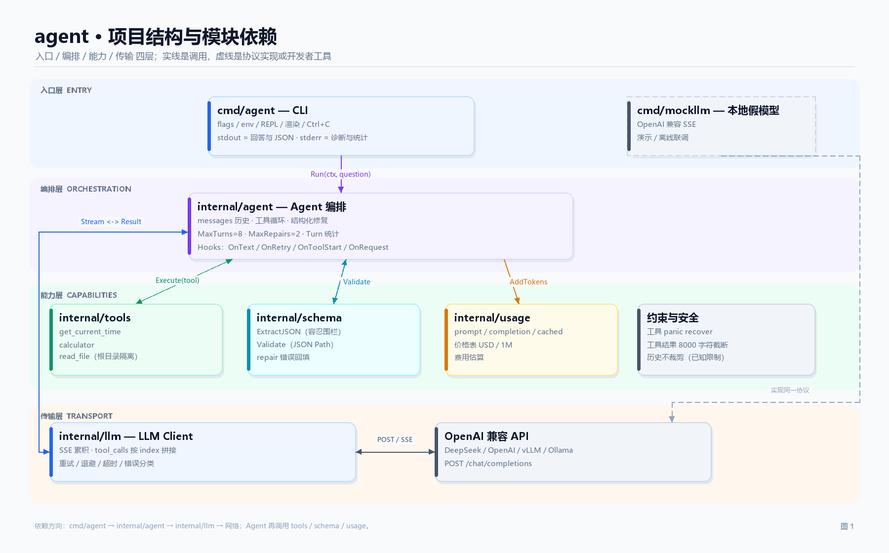
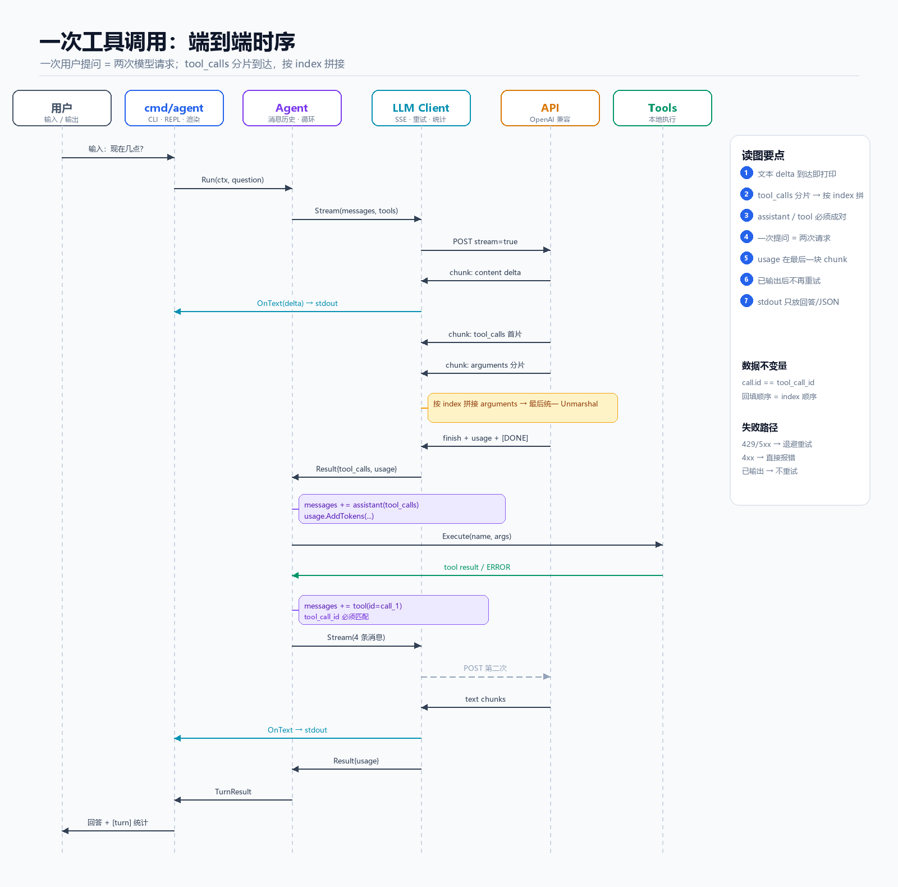
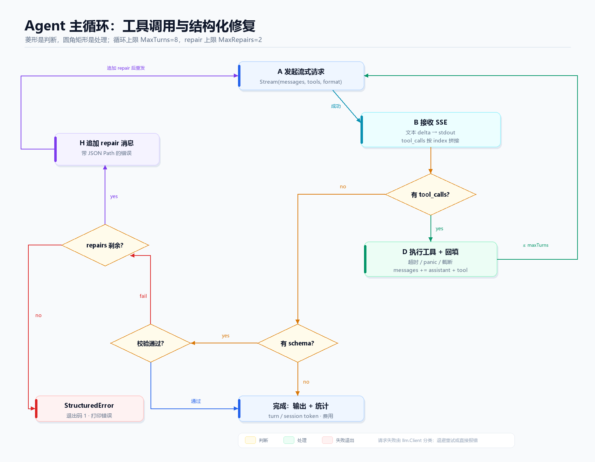

# 架构与流程图

本文用三张图拆解 `agent`：**模块怎么分层、一次工具调用怎么走、Agent 主循环怎么收敛**。
图片由 [`make_diagrams.py`](make_diagrams.py) 生成，可随时重绘。



## 1. 项目结构

```text
D:\agent
├── cmd/
│   ├── agent/                    # 可执行 CLI
│   │   ├── main.go               # 参数解析、子命令、启动
│   │   ├── app.go                # App 装配、单轮/REPL、斜杠命令
│   │   ├── render.go             # stdout/stderr 渲染、token/费用行
│   │   ├── console_windows.go    # Windows ANSI 支持
│   │   └── main_test.go          # CLI 级集成测试
│   └── mockllm/main.go           # 本地 OpenAI 兼容 SSE 服务
├── internal/
│   ├── llm/                      # 只负责“把一次请求可靠地跑完”
│   │   ├── client.go             # openai-go 包装、重试循环、超时
│   │   ├── accumulator.go        # SSE delta 累积、tool_calls 按 index 拼
│   │   ├── errors.go             # 错误分类、退避、Retry-After、提示
│   │   ├── types.go              # Result / Tokens / StreamOptions
│   │   └── accumulator_test.go
│   ├── agent/                    # 只负责“把多轮对话编排好”
│   │   └── agent.go              # 消息历史、工具循环、结构化修复
│   ├── tools/                    # 工具注册表 + 三个内置工具
│   ├── schema/                   # JSON Schema 子集 + JSON 提取
│   ├── usage/                    # token 汇总 + 价格表 + 费用
│   └── version/                  # 版本元数据（ldflags 注入）
├── schema/person.schema.json
├── scripts/demo.ps1
├── docs/                         # 本文与三张图
├── .github/workflows/ci.yml
├── CHANGELOG.md
├── go.mod / go.sum
└── README.md
```

依赖方向是单向的：

```text
cmd/agent
   ├──> internal/agent ──> internal/llm ──> openai-go ──> HTTPS
   │         ├──> internal/tools
   │         ├──> internal/schema
   │         └──> internal/usage ──> internal/llm（只复用 Tokens 类型）
   ├──> internal/usage（渲染费用）
   └──> internal/version（版本元数据）
```

`llm` 不知道工具和 Schema，`tools` 不知道 HTTP，`schema` 不知道网络。**编排只发生在 `agent`**，这是能单独测试每一层的前提。

## 2. 模块图怎么读

| 层 | 模块 | 职责 | 不负责 |
| --- | --- | --- | --- |
| 入口 | `cmd/agent` | 参数、环境变量、REPL、渲染、Ctrl+C、退出码 | 消息协议、重试 |
| 编排 | `internal/agent` | 维护 messages、工具循环、repair、Turn 统计 | HTTP、SSE 解析 |
| 能力 | `tools` / `schema` / `usage` | 工具执行、Schema 校验、计费 | 模型调用 |
| 传输 | `internal/llm` | 请求、SSE 累积、重试、超时、错误分类 | 工具业务、对话历史 |
| 外部 | OpenAI 兼容 API / `mockllm` | 生成 token、返回 tool_calls | 本地工具执行 |

两个关键边界：

1. **`llm.Client.Stream` 返回的是“一次逻辑请求”的结果**，不是“一次用户提问”。它内部可能重试 3 次，但调用方只看到 `Result{content, tool_calls, usage, attempts, elapsed}`。
2. **`agent.Agent.Run` 返回的是“一次用户提问”的结果**，可能包含 2~N 次 `Stream` 调用，`TurnResult` 里的 token 是这些请求的总和。

## 3. 一次工具调用的时序



按编号拆开：

| # | 方向 | 事件 | 关键动作 |
| --- | --- | --- | --- |
| 1 | 用户 → CLI | 输入问题 | REPL 或单轮参数 |
| 2 | CLI → Agent | `Run(ctx, question)` | 追加 `user` 消息 |
| 3 | Agent → LLM | `Stream(messages, tools)` | 带上 tools、`include_usage=true` |
| 4 | LLM → API | `POST /chat/completions` | `stream=true` |
| 5 | API → LLM | `content` delta | 普通文本增量 |
| 6 | LLM → CLI | `OnText(delta)` | 立刻写 stdout，不攒完整答案 |
| 7 | API → LLM | `tool_calls` 首片 | 带 `index` + `id` + `name` |
| 8 | API → LLM | `arguments` 分片 | 只有 `index` + 一段字符串 |
| 9 | LLM 内部 | 按 index 拼接 | 流结束后才整体 `json.Unmarshal` |
| 10 | API → LLM | `finish_reason` + usage + `[DONE]` | usage 在最后一块 |
| 11 | LLM → Agent | `Result{tool_calls, usage}` | 第一次请求结束 |
| 12 | Agent 内部 | `messages += assistant(tool_calls)` | 原样保留 id/name/arguments |
| 13 | Agent → Tools | `Execute(name, args)` | 30s 超时、panic recover、输出截断 |
| 14 | Tools → Agent | 结果或 `ERROR: ...` | 工具失败不终止循环 |
| 15 | Agent 内部 | `messages += tool(tool_call_id)` | 每个 call 必须有配对 tool 消息 |
| 16 | Agent → LLM | 第二次 `Stream` | 现在有 4 条消息（system/user/assistant/tool） |
| 17 | API → LLM | 最终文本 | 这次没有 tool_calls |
| 18 | Agent → CLI → 用户 | `TurnResult` + `[turn]` | 汇总两次请求的 token/费用 |

### 这里最容易错的三件事

1. **不能按到达顺序拼 tool_calls**：多个调用的分片会交错，`index` 才是稳定键；
2. **不能逐片 `json.Unmarshal`**：分片可能切在字符串、转义符、数字中间；
3. **不能只回填 assistant 不回填 tool**：下一次请求必须满足“每个 tool_call 都有 tool_call_id 匹配的 tool 消息”，否则 400。

## 4. Agent 主循环



主循环有 5 个判断点，对应 5 种“继续/退出”：

### 判断 1：请求成功吗？

失败时不是直接退出，而是先过“重试闸门”：

```text
可重试（429/5xx/网络） && 还没有任何可见输出 && 次数没用完
    -> 指数退避 + jitter（429 优先 Retry-After）
    -> 再请求

否则
    -> 分类错误（auth/rate_limit/server/network/...）
    -> 打印 Summary + Hint
    -> 退出 1
```

**已经输出过内容就绝不重试**，否则终端会重复；工具已经执行过也不重放整轮，避免副作用。

### 判断 2：有 tool_calls 吗？

有：执行工具 → 追加 `assistant(tool_calls)` 和每个 `tool(id)` → 回到判断 1 之前，发起下一次请求。

没有：进入“最终回答”路径。

这里的循环上限是 `MaxTurns=8`，防止模型反复调用工具。达到上限返回 `MaxTurnsError`。

### 判断 3：有 schema 吗？

没有：直接完成，打印文本和 token 统计。

有：进入结构化校验。

### 判断 4：校验通过吗？

通过：把原始 JSON 输出到 stdout（只输出 JSON），完成。

不通过：收集带 JSON Path 的错误，例如：

```text
$.age: expected integer, got string
$.name: required field is missing
```

### 判断 5：repair 次数还有吗？

有：追加一条 user 消息，把错误列表喂回模型，回到“发起请求”。

没有：返回 `StructuredError`，打印所有错误，退出 1。

`MaxTurns` 和 `MaxRepairs` 是两道独立保险：

- `MaxTurns` 限制“一次提问最多请求模型几次”；
- `MaxRepairs` 限制“结构化输出最多修几次”；
- 两者共同作用，任何一条路径都不会无限循环。

## 5. 状态机视角

```text
IDLE
  │ Run(question)
  ▼
REQUESTING ── 成功 ──> STREAMING ── 有 tool_calls ──> TOOL_EXEC ──> REQUESTING
  │                        │
  │                        └── 无 tool_calls ──> VALIDATING
  │                                                │
  │                                     通过 ──────┴──> DONE
  │                                     失败 ──> REPAIRING ──> REQUESTING
  │
  ├── 可重试且未输出 ──> BACKOFF ──> REQUESTING
  └── 不可重试/次数耗尽 ──> FAILED
```

对应到类型：

| 状态/结果 | 类型 |
| --- | --- |
| 一次逻辑请求 | `llm.Result` |
| 一次用户提问 | `agent.TurnResult` |
| 会话累计 | `usage.Stats`（Agent.Total） |
| 重试中 | `llm.RetryInfo` |
| 工具循环超限 | `agent.MaxTurnsError` |
| 结构化修复超限 | `agent.StructuredError` |
| 网络/API 失败 | `llm.Error`（带 Kind/Status/Attempts/Hint） |

## 6. 消息历史不变量

`Agent.messages` 是唯一的状态源，必须始终满足：

1. 第一条（可选）是 `system`；
2. 每个 `assistant(tool_calls=[...])` 后面，必须紧跟数量相同、`tool_call_id` 一一对应的 `tool` 消息；
3. tool 消息的顺序与 tool_calls 的 `index` 顺序一致；
4. `arguments` 是完整 JSON 字符串，不是半截；
5. 只有“请求成功”才会追加 assistant；失败请求不会留下半条 assistant 消息；
6. 修复轮会追加 `user(repair prompt)`，历史里保留上一次不合格的 assistant，模型能看到自己错在哪。

第 2、3 条由 `internal/agent/agent.go` 的循环保证，测试 `TestRunExecutesToolAndFeedsResultBack` 和 `TestParallelToolCallsAreExecutedInIndexOrder` 专门验证。

## 7. 数据流一句话版

```text
messages
   │
   ▼
llm.Stream ──> SSE chunks ──> Accumulator ──> Result
   │                                            │
   │              ┌── content ──> stdout         │
   │              ├── tool_calls ──> tools ──> tool message ──┐
   │              └── usage ──> usage.Stats ──> [turn]        │
   │                                                          │
   └──────────────────── 下一轮 messages <───────────────────┘
```

## 8. 失败/退出矩阵

| 场景 | 错误类型 | 退出码 |
| --- | --- | --- |
| 正常完成 | — | 0 |
| 参数错误（缺问题、非法 flag） | 普通 error | 2 |
| 网络/401/429/5xx 重试耗尽 | `llm.Error` | 1 |
| 工具调用死循环 | `MaxTurnsError` | 1 |
| 结构化修复耗尽 | `StructuredError` | 1 |
| Ctrl+C 取消单轮 | `context.Canceled` | 130 |

## 9. 重绘

```powershell
C:\Users\乔书祥\.dsh\dsh-runtimes\dsh-primary-runtime\dependencies\python\python.exe docs\make_diagrams.py
```

脚本只依赖 Pillow 和 Windows 自带的中文字体（Microsoft YaHei / Consolas），输出：

- `architecture.png`
- `sequence-tool-call.png`
- `agent-loop.png`
